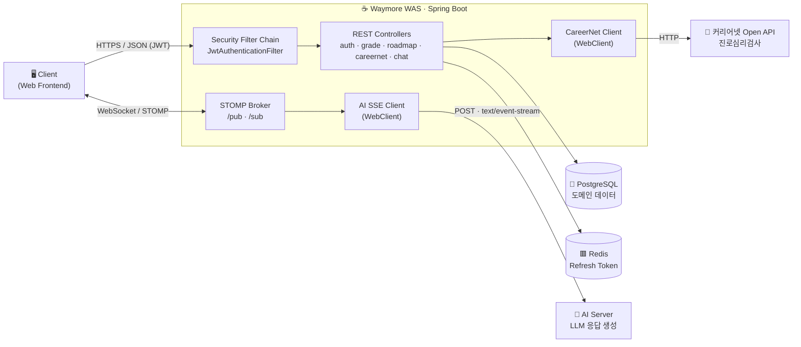
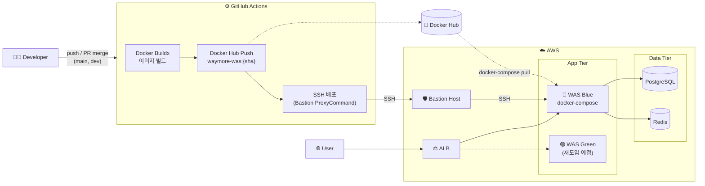
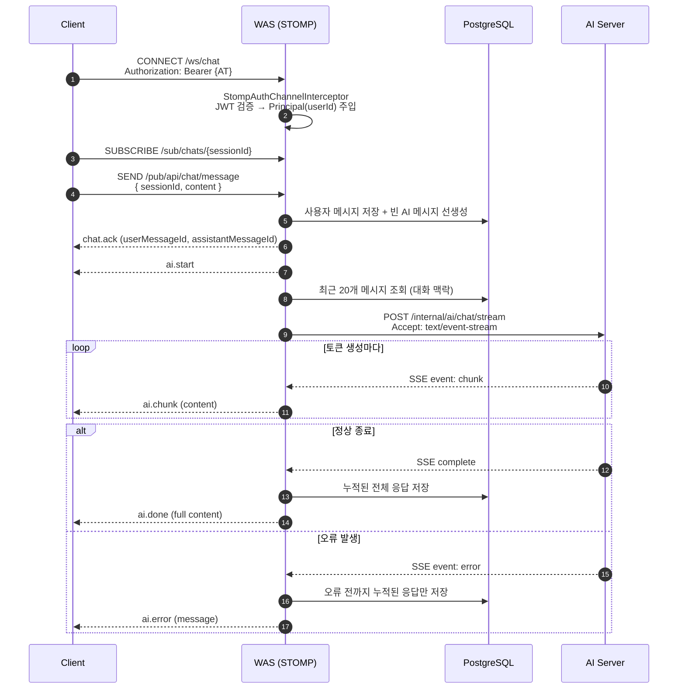
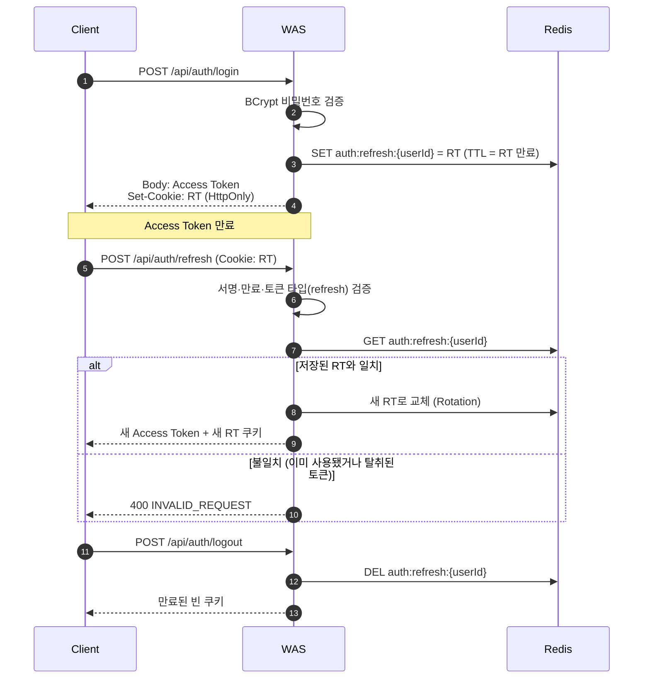
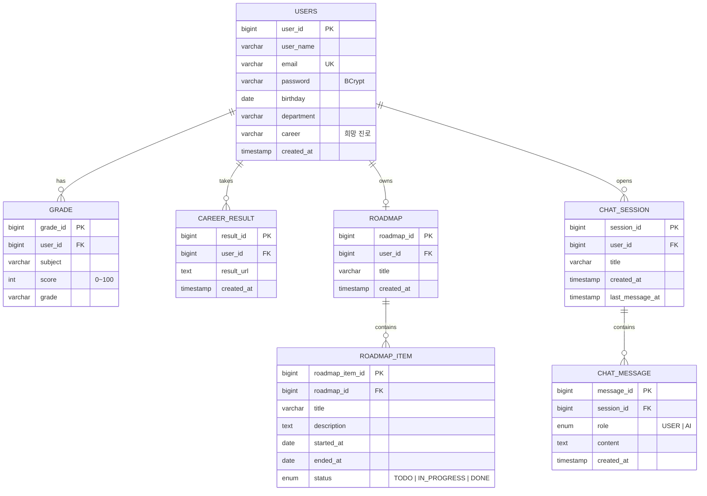

<div align="center">

# 🧭 Waymore Backend

**AI 진로 상담과 커리어넷 진로검사로 나만의 진로 로드맵을 만들어가는 서비스, Waymore의 백엔드 서버**

<br>


<br>


<br>


</div>

<br>

## 📌 목차

1. [프로젝트 소개](#-프로젝트-소개)
2. [주요 기능](#-주요-기능)
3. [시스템 아키텍처](#-시스템-아키텍처)
4. [핵심 구현](#-핵심-구현)
5. [기술적 의사결정](#-기술적-의사결정)
6. [트러블슈팅](#-트러블슈팅)
7. [ERD](#-erd)
8. [API 명세](#-api-명세)
9. [프로젝트 구조](#-프로젝트-구조)

<br>

## 💡 프로젝트 소개

진로를 고민하는 학생에게 필요한 건 **"나는 어떤 사람인지"** 와 **"그래서 무엇을 해야 하는지"** 입니다.

Waymore는 다음 기능을 하나의 흐름으로 연결합니다.

> **🧪 진로검사로 나를 알고 → 💬 AI와 상담하며 방향을 잡고 → 🗺️ 로드맵으로 실행한다**

- 커리어넷 진로심리검사 결과로 **나의 적성과 흥미를 파악**하고
- 성적·희망 진로를 바탕으로 **AI와 실시간 진로 상담**을 하며
- 해야 할 일을 **로드맵 아이템(TODO → IN_PROGRESS → DONE)** 으로 관리합니다.

이 레포지토리는 인증, 도메인 데이터 관리, 외부 API(커리어넷) 연동, **AI 서버와 클라이언트 사이의 실시간 스트리밍 중계**를 맡는 **WAS(Spring Boot)** 입니다.

<br>

## ✨ 주요 기능

| 기능 | 설명 |
| :---: | --- |
| 🔐 **회원 / 인증** | JWT Access Token + HttpOnly 쿠키 Refresh Token, Redis 기반 **Refresh Token Rotation** |
| 📊 **성적 관리** | 과목별 점수·등급 등록 / 조회 / 수정 / 삭제 |
| 🧪 **진로심리검사** | 커리어넷 Open API 연동 (직업흥미·적성·가치관·진로성숙도 등 18종 검사) |
| 💬 **AI 진로 상담** | WebSocket(STOMP) + SSE 기반 **실시간 토큰 스트리밍 채팅**, 대화 내역 저장 |
| 🗺️ **진로 로드맵** | 회원가입 시 학과·희망 진로 기반 로드맵 자동 생성, 아이템 단위 진행 상태 관리 |
| 🚀 **CI/CD** | GitHub Actions → Docker Hub → Bastion 경유 배포, Actuator 헬스체크로 배포 결과 검증 |

<br>

## 🏗 시스템 아키텍처

### 서비스 구성



### 인프라 & 배포 파이프라인



<br>

## 🔍 핵심 구현

### 1. WebSocket(STOMP) + SSE로 AI 응답 실시간 스트리밍 중계

LLM 응답은 생성에 수 초에서 수십 초가 걸립니다. 전체 응답을 기다렸다가 한 번에 보내면 사용자 경험이 크게 떨어지므로, **AI 서버의 SSE 스트림을 받아 STOMP로 클라이언트에 바로 중계**하는 구조를 설계했습니다.



**설계 포인트**
- **AI 메시지 ID 선발급**: 스트리밍 시작 전에 빈 AI 메시지를 먼저 저장하고 `assistantMessageId`를 `chat.ack`로 내려줍니다. 클라이언트는 이후 들어오는 chunk를 어떤 말풍선에 붙일지 바로 알 수 있습니다.
- **이벤트 타입 표준화**: `chat.ack → ai.start → ai.chunk* → ai.done | ai.error`로 상태를 명확히 나눠, 프론트엔드가 로딩·스트리밍·완료·실패 UI를 상태 기반으로 그릴 수 있게 했습니다.
- **부분 응답 보존**: AI 서버 오류가 나도 그때까지 받은 응답은 버리지 않고 저장합니다.
- **대화 맥락 전달**: 최근 20개 메시지를 시간순으로 정렬해 history로 함께 보내, AI가 이전 대화를 이어갈 수 있게 했습니다.
- **채팅방 자동 생성**: `sessionId` 없이 메시지를 보내면 채팅방을 만들고, 첫 메시지 앞 20자를 제목으로 씁니다.

### 2. Redis 기반 Refresh Token Rotation



- **Access Token은 응답 본문, Refresh Token은 `HttpOnly` 쿠키**로 분리해, 스크립트로 RT를 읽을 수 없게 해 XSS로 인한 탈취 위험을 줄였습니다.
- 재발급할 때마다 RT를 새로 발급하고 Redis 값을 덮어씁니다. 이전 RT는 즉시 무효가 되므로 **탈취된 RT를 재사용할 수 없습니다.**
- Redis TTL을 RT 만료 시간과 맞춰, 만료된 토큰이 별도 정리 작업 없이 자동으로 지워집니다.
- 쿠키의 `Secure`, `SameSite`, `Path`는 환경 변수로 주입해 로컬(HTTP)과 운영(HTTPS, Cross-site) 환경을 같은 코드로 처리합니다.
- 같은 JWT 검증 로직을 **HTTP 필터(`JwtAuthenticationFilter`)와 STOMP 인터셉터(`StompAuthChannelInterceptor`)** 두 곳에 적용해 REST와 WebSocket의 인증 정책을 통일했습니다.

### 3. 외부 API(커리어넷) 연동과 장애 격리

- 커리어넷 API Key는 **서버에서만 주입**하므로 클라이언트에 노출되지 않습니다.
- 응답 Content-Type을 믿지 않고 **문자열로 받은 뒤 직접 JSON 파싱**해, 커리어넷이 비정상 응답을 보내도 명확한 에러로 처리합니다.
- 4xx/5xx, 파싱 실패, API Key 누락을 모두 `CareerNetApiException`으로 변환하고 **전용 `CareerNetExceptionHandler`** 에서 처리합니다. 외부 시스템 장애가 내부 도메인의 예외 흐름과 섞이지 않습니다.
- 에러 메시지에 들어가는 외부 응답 본문은 200자로 잘라, 로그와 응답이 과도하게 커지는 것을 막았습니다.

### 4. 일관된 응답·예외 처리

- 모든 도메인 API를 `CommonResponseDto { status, data, message }` 형식으로 통일했습니다.
- `ErrorCode` enum이 HTTP 상태와 메시지를 함께 관리하고, `BusinessException`과 `GlobalExceptionHandler`로 예외를 한 곳에서 처리합니다.
- 요청 DTO는 Java `record`와 Bean Validation(`@NotBlank`, `@Size`, `@Past`, `@Min/@Max` 등)으로 Controller 진입 시점에 검증합니다.

<br>

## 🤔 기술적 의사결정

| 고민 | 선택 | 이유 |
| --- | --- | --- |
| AI 응답을 클라이언트에 어떻게 실시간으로 전달할까? | **STOMP (WebSocket)** | 채팅방 단위 Pub/Sub(`/sub/chats/{id}`)을 프로토콜 수준에서 지원합니다. 양방향 통신이라 메시지 전송과 응답 수신을 하나의 연결로 처리할 수 있습니다. |
| WAS ↔ AI 서버 통신 방식은? | **SSE + WebClient** | AI 서버는 단방향으로 토큰만 흘려보내면 되므로 SSE가 가장 단순합니다. WebClient의 `Flux`로 받으면 스트림을 블로킹 없이 처리할 수 있습니다. |
| Refresh Token을 어디에 저장할까? | **Redis** | 요청마다 조회되는 휘발성 데이터라 RDB보다 빠른 인메모리 저장소가 적합합니다. TTL로 만료 데이터가 자동으로 정리되고, 로그아웃 시 즉시 무효화할 수 있습니다. |
| 스키마는 누가 관리할까? | **`init.sql` + `ddl-auto: validate`** | Hibernate가 운영 DB 스키마를 바꾸지 못하게 막고, 엔티티와 스키마가 다르면 애플리케이션 기동 시점에 바로 실패하도록 했습니다. PostgreSQL ENUM 타입도 명시적으로 관리합니다. |
| 테스트 DB는? | **Testcontainers (PostgreSQL)** | H2와 실제 PostgreSQL의 방언 차이(ENUM, IDENTITY 등)로 생기는 "테스트는 통과했는데 운영에서 실패"하는 상황을 피합니다. |
| 운영 서버 접근은? | **Bastion Host 경유 SSH** | App 서버를 외부에 직접 노출하지 않고, Bastion을 거치는 ProxyCommand로만 배포합니다. |
| 무중단 배포는? | **ALB Target Group 스위칭 (Blue/Green)** | ALB 리스너의 활성 Target Group을 조회해 비활성 슬롯에 배포한 뒤 트래픽을 전환하도록 설계했습니다. |

<br>

## 🔥 트러블슈팅

<details>
<summary><b>① 커리어넷 클라이언트 ObjectMapper 주입 실패 & 응답 직렬화 오류</b></summary>

<br>

**문제**
- `CareerNetClient`에서 `ObjectMapper`를 생성자로 주입받도록 작성했는데, 애플리케이션 기동 시 빈 주입 오류가 발생했습니다.
- 수정 후에는 커리어넷 응답을 `JsonNode`로 그대로 반환하자, 응답 직렬화 과정에서 오류가 발생했습니다.

**원인**
- Spring Boot 4부터 기본 JSON 라이브러리가 Jackson 3(`tools.jackson`)로 바뀌었습니다. 그래서 기존 Jackson 2(`com.fasterxml.jackson`)의 `ObjectMapper` 빈이 자동 등록되지 않았습니다.
- 마찬가지로 Jackson 2의 `JsonNode`는 Jackson 3 기반 메시지 컨버터에서 정상적으로 직렬화되지 않았습니다.

**해결**
- 클라이언트 내부에서 `JsonMapper.builder().build()`로 파서를 직접 만들어 외부 응답 파싱에만 사용했습니다.
- 반환 타입을 `JsonNode`에서 `Map<String, Object>`로 바꿔, 프레임워크의 기본 직렬화에 맡겨도 커리어넷 원본 필드가 그대로 내려가게 했습니다.

**배운 점**
- 메이저 버전을 올릴 때는 **전이 의존성(Jackson 등)의 기본값 변경**까지 확인해야 합니다.
- 외부 API 응답처럼 스키마가 불확실한 데이터는 **프레임워크 고유 타입보다 표준 컬렉션 타입**으로 다루는 편이 경계가 명확합니다.

</details>

<details>
<summary><b>② CI/CD 배포 스크립트 실패 (docker compose 명령어 & 권한)</b></summary>

<br>

**문제**
- GitHub Actions에서 SSH로 원격 서버에 접속해 `docker compose`를 실행하는 단계가 계속 실패했습니다.

**원인**
- 대상 VM에 Compose V2 플러그인(`docker compose`)이 없고 standalone 바이너리(`docker-compose`)만 설치되어 있었습니다.
- 배포 디렉터리와 `.env.was` 파일이 root 소유라서, 배포 계정으로는 수정·실행할 수 없었습니다.

**해결**
- 명령어를 `docker-compose`로 통일하고, `sudo`로 실행하도록 바꿨습니다.
- 이미지 태그를 커밋 SHA로 고정하고, `sed`로 `.env.was`의 `WAS_IMAGE` 값만 교체하도록 해 **어떤 커밋이 배포됐는지 추적**할 수 있게 했습니다.
- 배포 후 `/actuator/health`를 최대 10회 폴링해 `UP`이 아니면 워크플로를 실패시켜, **배포 성공 여부를 자동으로 검증**하도록 했습니다.

</details>

<details>
<summary><b>③ WebSocket 연결 시 인증 정보 누락</b></summary>

<br>

**문제**
- REST API는 `JwtAuthenticationFilter`로 인증되는데, STOMP 메시지 핸들러에서는 `Principal`이 `null`로 들어왔습니다.

**원인**
- WebSocket은 최초 HTTP 핸드셰이크 이후 별도 프레임으로 통신하기 때문에, 서블릿 필터 기반 인증 정보가 STOMP 세션에 자동으로 이어지지 않습니다. 브라우저 WebSocket API로는 핸드셰이크에 커스텀 헤더를 붙이기도 어렵습니다.

**해결**
- `ChannelInterceptor`를 구현해 STOMP `CONNECT` 프레임의 native header(`Authorization`)에서 JWT를 꺼내 검증했습니다.
- 검증된 `userId`를 `accessor.setUser()`로 세션 Principal에 주입해, 이후 모든 메시지에서 사용자를 식별할 수 있게 했습니다.

</details>

<br>

## 🗂 ERD



> 스키마 원본: [`db/init.sql`](db/init.sql) · 회원가입 시 `"{학과} {희망 진로} 로드맵"` 제목의 로드맵이 자동으로 생성됩니다.

<br>

## 📡 API 명세

> 📖 전체 명세는 서버 실행 후 **Swagger UI** → `/swagger-ui.html`
> 🔒 표시된 API는 `Authorization: Bearer {accessToken}` 헤더가 필요합니다.

<details>
<summary><b>🔐 인증 · <code>/api/auth</code></b></summary>

| Method | URI | 설명 | |
| :---: | --- | --- | :---: |
| `POST` | `/api/auth/join` | 회원가입 (로드맵 자동 생성 + 토큰 발급) | |
| `POST` | `/api/auth/login` | 로그인 | |
| `POST` | `/api/auth/refresh` | 토큰 재발급 (Refresh Token Rotation) | |
| `GET` | `/api/auth/user` | 내 정보 조회 | 🔒 |
| `POST` | `/api/auth/logout` | 로그아웃 | 🔒 |

</details>

<details>
<summary><b>📊 성적 · <code>/api/grade</code></b></summary>

| Method | URI | 설명 | |
| :---: | --- | --- | :---: |
| `POST` | `/api/grade/` | 성적 등록 | 🔒 |
| `GET` | `/api/grade/` | 내 전체 성적 조회 | 🔒 |
| `PATCH` | `/api/grade/{gradeId}` | 성적 수정 | 🔒 |
| `DELETE` | `/api/grade/{gradeId}` | 성적 삭제 | 🔒 |

</details>

<details>
<summary><b>🗺️ 로드맵 · <code>/api/roadmap</code></b></summary>

| Method | URI | 설명 | |
| :---: | --- | --- | :---: |
| `GET` | `/api/roadmap/` | 내 로드맵 조회 (아이템 포함) | 🔒 |
| `GET` | `/api/roadmap/{itemId}` | 로드맵 아이템 단건 조회 | 🔒 |
| `POST` | `/api/roadmap/item` | 로드맵 아이템 추가 | 🔒 |
| `PATCH` | `/api/roadmap/item/{roadmapItemId}` | 로드맵 아이템 수정 | 🔒 |
| `DELETE` | `/api/roadmap/item/{roadmapItemId}` | 로드맵 아이템 삭제 | 🔒 |
| `DELETE` | `/api/roadmap/{roadmapId}` | 로드맵 삭제 | 🔒 |
| `POST` | `/api/roadmap/recommend` | AI 로드맵 추천 *(개발 중)* | 🔒 |

</details>

<details>
<summary><b>🧪 진로심리검사 · <code>/api/careernet</code></b></summary>

| Method | URI | 설명 | |
| :---: | --- | --- | :---: |
| `GET` | `/api/careernet/tests` | 지원 검사 목록 조회 | 🔒 |
| `GET` | `/api/careernet/tests/{qno}/questions` | 검사 문항 조회 | 🔒 |
| `POST` | `/api/careernet/reports` | 답변 제출 및 결과 요청 | 🔒 |

</details>

<details>
<summary><b>💬 채팅 · <code>/api/chat</code> + STOMP</b></summary>

**REST**

| Method | URI | 설명 | |
| :---: | --- | --- | :---: |
| `GET` | `/api/chat` | 채팅방 목록 조회 | 🔒 |
| `GET` | `/api/chat/{sessionId}` | 채팅방 상세 (메시지 내역) | 🔒 |
| `POST` | `/api/chat/sessions` | 새 채팅방 생성 | 🔒 |

**STOMP**

| 구분 | Destination | 설명 |
| --- | --- | --- |
| Endpoint | `/ws/chat` | `CONNECT` 시 `Authorization: Bearer {AT}` native header 필요 |
| Publish | `/pub/api/chat/message` | `{ "sessionId": 1, "content": "..." }` (sessionId 생략 시 새 채팅방) |
| Subscribe | `/sub/chats/{sessionId}` | `chat.ack` · `ai.start` · `ai.chunk` · `ai.done` · `ai.error` |

```json
{
  "type": "ai.chunk",
  "sessionId": 1,
  "userMessageId": null,
  "assistantMessageId": 12,
  "content": "먼저 ",
  "message": null
}
```

</details>

**공통 응답 형식**

```json
{
  "status": "success",
  "data": { },
  "message": "요청이 성공적으로 처리되었습니다."
}
```

<br>

## 📁 프로젝트 구조

도메인 중심 패키지 구조로, 각 도메인은 `controller → service → repository → domain` 계층과 `dto`로 구성됩니다.

```
src/main/java/com/teameau/waymore
├── 📂 config        # SecurityConfig (JWT · CORS), OpenApiConfig (Swagger)
├── 📂 common        # CommonResponseDto, ErrorCode, BusinessException, GlobalExceptionHandler
├── 📂 user          # 인증(JWT 발급·검증, Refresh Token, 쿠키) · 회원 · 성적
├── 📂 careernet     # 커리어넷 Client · 검사 카탈로그 · 전용 예외 핸들러
├── 📂 roadmap       # 로드맵 · 로드맵 아이템
└── 📂 chat
    ├── config       # WebSocketConfig, STOMP 인증 인터셉터
    ├── client       # AI 서버 SSE 클라이언트 (인터페이스 + WebClient 구현체)
    ├── controller   # REST(조회·생성) + STOMP(메시지 전송)
    └── service      # Command(전송·스트리밍) / Query(조회) 분리

db/                  # 초기 스키마 (init.sql)
deploy/app           # 운영 WAS docker-compose
deploy/db            # 운영 PostgreSQL · Redis docker-compose
.github/workflows    # CI/CD 파이프라인
```
